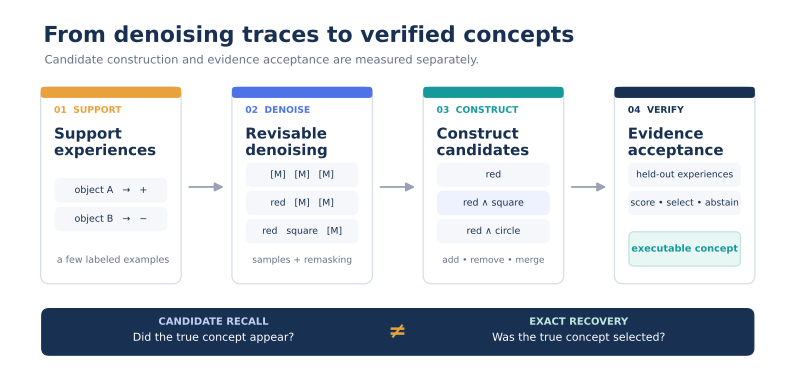
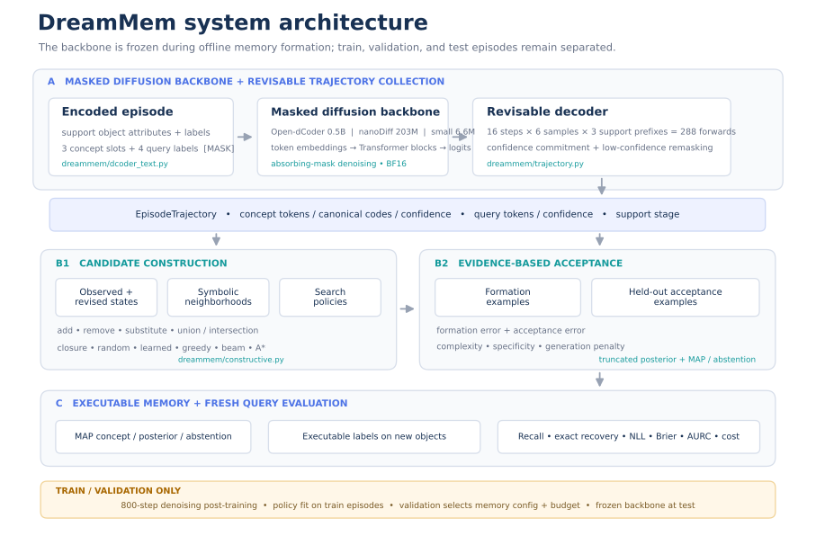
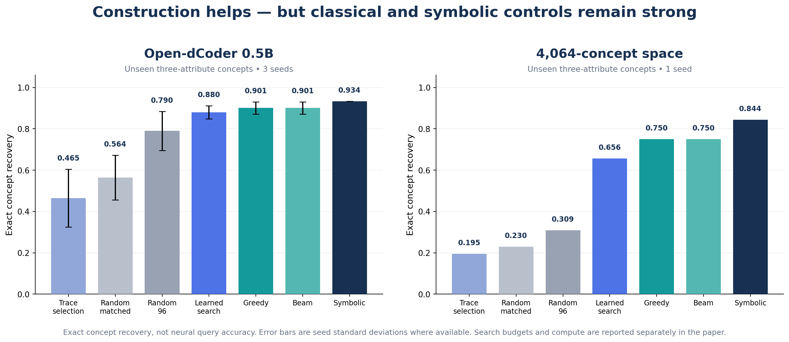

# DreamMem

**Evidence-Guided Constructive Memory in Masked Diffusion Language Models**

从 masked diffusion LM 的可修订去噪轨迹出发，构造候选概念，再用独立真实经历验收为可执行的离散记忆。

[方法](#method) · [系统架构](#system-architecture) · [核心结论](#core-finding) · [结果](#results) · [快速开始](#quick-start) · [完整论文](PAPER.md) · [实验手册](docs/EXPERIMENTS.md)


> **Research scope:** DreamMem is a controlled synthetic research environment for experience-to-query concept induction. It is not evidence of biological dreaming, permanent weight-level memory, or unrestricted natural-language understanding.

<a id="method"></a>
## Method



DreamMem separates two operations that are easy to conflate:

1. **Candidate construction:** collect observed and revised concepts from denoising trajectories, then expand them with symbolic neighborhood operators.
2. **Candidate acceptance:** score candidates on formation experiences and separate held-out acceptance experiences, producing an executable concept or posterior.

This makes it possible to measure **candidate recall** and **exact concept recovery** independently. A true concept appearing in the candidate pool does not imply that the system will select it.

<a id="system-architecture"></a>
## System architecture



The implementation separates backbone adapters and trajectory collection (`dcoder.py`, `nanodiff_adapter.py`, `trajectory.py`) from constructive search and evidence acceptance (`constructive.py`, `memory.py`, `evaluation.py`). Denoising post-training and policy fitting use train episodes; validation episodes select memory configurations and budgets. During offline memory formation and fresh-query testing, the backbone remains frozen and the hidden concept is not an input.

<a id="core-finding"></a>
## Core finding

**候选能够被构造出来，不等于能够被正确识别。** 项目最可靠的结果不是“dLLM 会做梦”，而是：**建设性候选生成与真实证据验收必须分开建模和评价。**

- Constructive search substantially outperforms final-state selection and budget-matched random neighborhood search on unseen compositional concepts.
- Classical greedy and beam search often outperform the learned controller; symbolic enumeration remains a strong reference.
- Removing trajectory features generally does not hurt the controller, so the results do **not** establish a unique advantage of temporal denoising dynamics.
- Backend, support size, label noise, and operator novelty materially change the outcome.

<a id="results"></a>
## Results



Exact concept recovery on unseen three-attribute concepts:

| Environment | Trace selection | Random matched | Random 96 | Learned search | Greedy / Beam | Symbolic |
|---|---:|---:|---:|---:|---:|---:|
| Open-dCoder 0.5B, 3 seeds | 0.4648 | 0.5638 | 0.7904 | **0.8802 ± 0.0316** | 0.9010 / 0.9010 | **0.9336** |
| 4,064 concepts, 1 seed | 0.1953 | 0.2305 | 0.3086 | 0.6563 | **0.7500 / 0.7500** | **0.8438** |
| nanoDiff, 1 seed | 0.0000 | 0.0352 | 0.0352 | **0.1250** | 0.1055 / 0.1094 | **0.9336** |

Additional completed studies include relational concepts, nine advanced-operator splits, multi-template semantics, 10%/25% label noise, support sizes 2/4/16/32, AR/MLM decoder controls, full-space ranking, and detailed search-cost audits.

**Do not read these numbers as universal superiority.** Symbolic references remain stronger, several important extensions are single-seed, and neural query accuracy is reported separately from executable-program query accuracy.

[Full paper](PAPER.md) · [Detailed experimental record](docs/EXPERIMENTS.md) · [Released aggregate tables](docs/results/) · [Cost–quality figure](docs/assets/search_cost_tradeoff.png)

## What “sleep” means here

During offline memory formation, the model receives **no new external data**. It revisits saved experiences through masking, denoising, candidate construction, and evidence-based acceptance. Weights are not consolidated during this stage. The resulting memory is a discrete executable concept evaluated on fresh queries within the episode.

<a id="quick-start"></a>
## Quick start

### Install

```bash
git clone --recurse-submodules https://github.com/xiaoyangyyy/DreamMem.git
cd DreamMem
python -m venv .venv
source .venv/bin/activate  # Windows PowerShell: .venv\Scripts\Activate.ps1
python -m pip install -e .
```

Dependencies are declared in `pyproject.toml`. A CUDA GPU is recommended for external-model experiments; the small synthetic Transformer can be trained on more modest hardware.

### Inspect a configuration

```bash
python -m dreammem inspect --config configs/full.yaml
```

### Train and evaluate the small masked-diffusion model

```bash
python -m dreammem train --config configs/full.yaml --seed 17
python -m dreammem evaluate \
  --config configs/full.yaml \
  --checkpoint outputs/full/seed_17/best.pt
```

### Regenerate the README figures from the released aggregate tables

```bash
python scripts/draw_readme_figures.py
```

For Open-dCoder and nanoDiff experiments, download the original checkpoints separately from [Open-dCoder-0.5B](https://huggingface.co/fredzzp/open-dcoder-0.5B) and [nanoDiff](https://github.com/BY571/nanoDiff). Model weights are not bundled. The complete external-model pipeline and all evaluation commands are documented in [`docs/EXPERIMENTS.md`](docs/EXPERIMENTS.md).

## Repository layout

```text
dreammem/          Model adapters, trajectory collection, memory formation, search
scripts/           Training, evaluation, audits, ablations, statistics, figures
configs/           Base, relational, advanced, large, semantic, noise, support configs
docs/assets/       Method diagram and publication-ready result figures
docs/results/      Aggregate metrics, paired effects, costs, and final audit
PAPER.md           Complete research manuscript
```

The repository includes selected aggregate results rather than approximately 19 GB of raw trajectories, episode-level outputs, and local checkpoints. The final audit covers **18 runs and 208,896 primary per-episode result rows** in the original experimental environment.

## Reproducibility and audit

The machine audit checks training steps, split/episode/method grids, duplicate keys, seeds, trajectories, oracle predictions, cost accounting, ablations, and agreement between main and audit results.

```bash
python scripts/validate_project.py --final
python -m compileall -q dreammem scripts
```

Running the full audit requires the original generated outputs. The released audit certificate is available at [`docs/results/validation.json`](docs/results/validation.json), and the final inventory is at [`docs/results/inventory.csv`](docs/results/inventory.csv).

## Limitations

- All environments are synthetic and have known executable semantics.
- Exact recovery depends on the candidate language and legal-family constraints.
- Direct learned ranking is better on some seen/unseen splits but can fail almost completely on novel compositions.
- New operators, unseen textual templates, and 25% support-label noise expose clear failure boundaries.
- AR/MLM comparisons differ in sampling and iterative structure; they are not architecture-isolating proofs.
- The results do not show that learned controllers are necessary or that masked diffusion universally outperforms autoregressive models.

## Third-party components

Open-dCoder and nanoDiff are external research models. nanoDiff is included as a pinned Git submodule and retains its original MIT license in `vendor/nanoDiff/LICENSE`. No additional top-level license is asserted by this repository snapshot.
